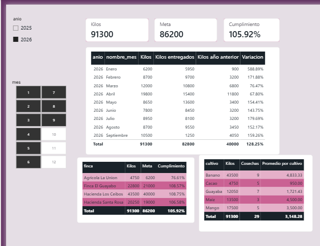

# AgroDB Integrator — PC3: Metas y análisis de cosechas

## Objetivo

Integrar las metas de producción al modelo de Power BI y analizar los kilos cosechados, el cumplimiento de las metas, los kilos entregados y la comparación con el año anterior. Presentar los resultados por mes, finca y cultivo.

## Modelo y preparación de datos

- **Tabla de hechos `h_cosecha`:** registros de cosechas con kilos, fechas, finca y cultivo.
- **Tabla de metas `h_meta`:** 48 registros (4 fincas × 12 meses), con los campos `finca_id`, `fecha_mes` y `kg_meta`.
- **Dimensión `dim_tiempo`:** permite filtrar por año y mes.
- **Relación activa:** `dim_tiempo[fecha]` → `h_cosecha[fecha]`, de uno a varios y con dirección de filtro única.
- **Relación inactiva:** `dim_tiempo[fecha]` → `h_cosecha[fecha_entrega]`, utilizada para analizar kilos según la fecha de entrega.
- Se corrigió la interpretación de fechas en formato estadounidense de la fuente digital para evitar errores de conversión en `fecha_entrega`.

## Medidas DAX

### Medidas base

```dax
Kilos = SUM(h_cosecha[kg])
```

```dax
Cosechas = COUNTROWS(h_cosecha)
```

### Medidas de PC3

```dax
Meta = SUM(h_meta[kg_meta])
```

```dax
Cumplimiento =
IF(
    ISINSCOPE(dim_cultivo[cultivo]),
    BLANK(),
    DIVIDE([Kilos], [Meta])
)
```

```dax
Kilos entregados =
CALCULATE(
    [Kilos],
    USERELATIONSHIP(h_cosecha[fecha_entrega], dim_tiempo[fecha])
)
```

```dax
Kilos año anterior =
CALCULATE(
    [Kilos],
    SAMEPERIODLASTYEAR(dim_tiempo[fecha])
)
```

```dax
Variacion =
DIVIDE(
    [Kilos] - [Kilos año anterior],
    [Kilos año anterior]
)
```

```dax
Promedio por cultivo =
DIVIDE([Kilos], [Cosechas])
```

> Las medidas `Cumplimiento` y `Variacion` se presentan con formato de porcentaje en Power BI. La medida `Cumplimiento` se deja en blanco cuando se desglosa por cultivo, ya que no se asignaron metas a ese nivel.

## Resultados validados

**Filtros aplicados:** año **2026**, meses **enero a septiembre (1–9)**.

| Indicador | Resultado |
|---|---:|
| Kilos cosechados | 91.300 kg |
| Meta acumulada | 86.200 kg |
| Cumplimiento | 105,92 % |
| Diferencia sobre la meta | +5.100 kg |
| Kilos entregados | 82.800 kg |
| Kilos del año anterior | 40.000 kg |
| Variación acumulada frente al año anterior | 128,25 % |
| Número de cosechas | 29 |
| Promedio de kilos por cosecha | 3.148,28 kg |

La **meta anual completa de 2026** es de **110.000 kg**. Al filtrar enero–septiembre, la meta correspondiente al período es **86.200 kg**; no deben confundirse ambos valores.

### Análisis por finca

| Finca | Kilos | Meta | Cumplimiento |
|---|---:|---:|---:|
| Agrícola La Unión | 4.750 | 6.200 | 76,61 % |
| Finca El Guayabo | 22.800 | 21.000 | 108,57 % |
| Hacienda Los Ceibos | 43.500 | 40.000 | 108,75 % |
| Hacienda Santa Rosa | 20.250 | 19.000 | 106,58 % |
| **Total** | **91.300** | **86.200** | **105,92 %** |

### Análisis por cultivo

| Cultivo | Kilos | Cosechas | Promedio por cultivo |
|---|---:|---:|---:|
| Banano | 43.500 | 9 | 4.833,33 |
| Cacao | 4.750 | 5 | 950,00 |
| Guayaba | 12.050 | 7 | 1.721,43 |
| Maíz | 13.500 | 3 | 4.500,00 |
| Mango | 17.500 | 5 | 3.500,00 |
| **Total** | **91.300** | **29** | **3.148,28** |

### Comprobaciones puntuales

- **Enero de 2026:** 6.200 kg cosechados; 5.950 kg entregados; 900 kg en enero del año anterior; variación **588,89 %**.
- **Total enero–septiembre:** variación **128,25 %**, calculada con los totales del período, no como suma ni promedio de porcentajes mensuales.
- El cumplimiento se calcula sobre la meta correspondiente al período filtrado: **91.300 / 86.200 × 100 = 105,92 %**.

## Evidencia visual

Captura del dashboard final con los segmentadores de año y mes, las tarjetas de Kilos, Meta y Cumplimiento, la comparación mensual, el desglose por finca y el análisis por cultivo:



> Para que la imagen se muestre en el repositorio, guardar `proyecto-pc3-resultados.png` en la misma carpeta que este archivo Markdown.

## Conclusión

El PC3 permite comparar la producción real contra las metas por finca y período, analizar los kilos según su fecha de entrega, contrastar resultados con el año anterior y revisar el rendimiento por cultivo. Para enero–septiembre de 2026 se registraron **91.300 kg** frente a una meta acumulada de **86.200 kg**, alcanzando **105,92 %** de cumplimiento.
